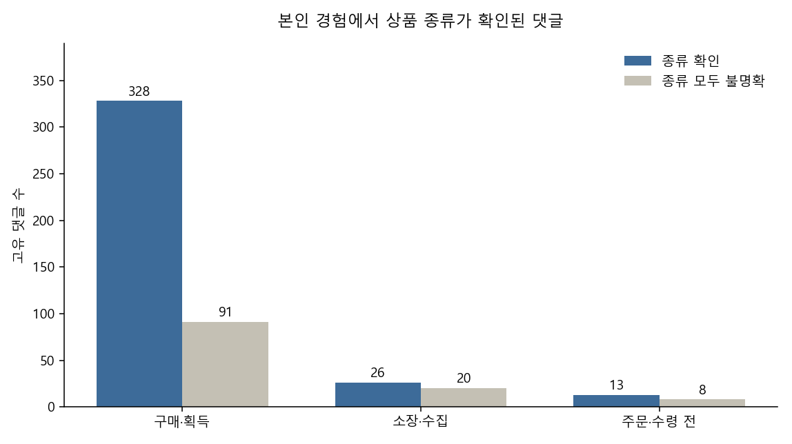
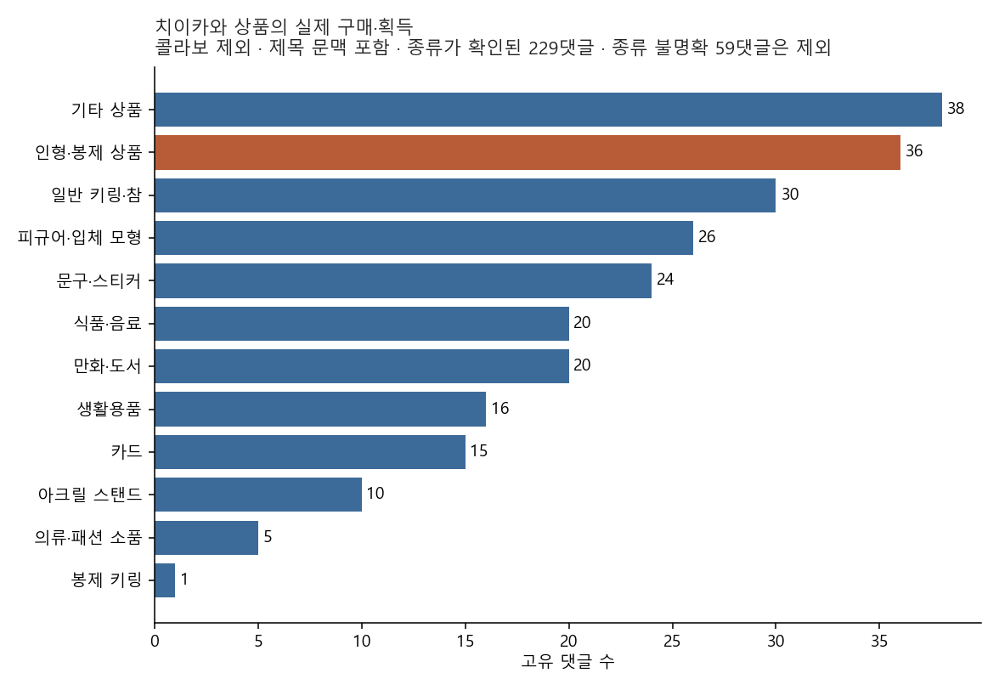
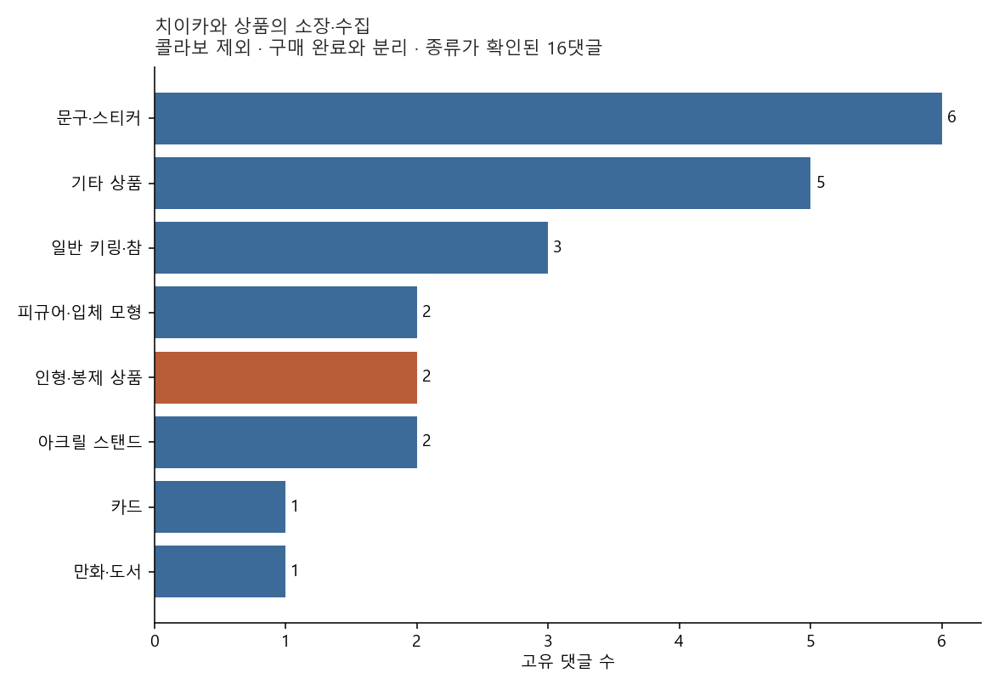
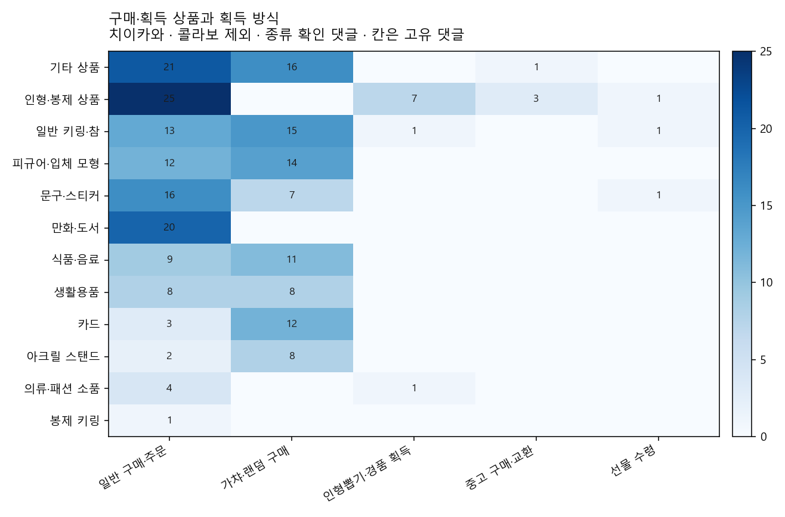

# 상품 소비 문맥 분석

구매·획득·소장 후보 749건을 댓글과 제목으로 읽었다. 작성자 본인 또는 동행의 실제 구매·획득은 419건이다. 그중 치이카와 상품으로 확인되고 종류까지 읽히는 229건에서 인형·봉제는 36건으로, 기타 상품 38건과 맞닿아 있다. 인형은 반복해서 보이지만 과반은 아니고, 근거 범위에 따라 1위가 바뀌므로 인형이 주요 상품이라는 판단은 보류한다.

이 749건은 규칙으로 걸러 낸 경험 후보다. 판매량, 시장점유율, 전체 소비자 구매율로 읽지 않는다. 집계 단위는 고유 댓글이다. 소비 관계 777행은 구매 건수가 아니다. 채널 수는 댓글 작성자가 아니라 영상이 올라온 채널이다.

## 실제 소비 경험으로 확인된 범위

입력은 1차 분류의 구매·획득 후보 671건과 소장·수집 후보 85건의 합집합이다. 겹치는 7건을 빼면 749건이고, 출력 댓글 ID와 같다. 구매 의향 952건과 질문·미구매 후보는 이번에 넣지 않았다.

| 댓글 판정 | 댓글 |
|---|---:|
| 상품 구매·획득·소장 | 473 |
| 질문·의향·미구매 | 130 |
| 비상품 소비 | 54 |
| 무관·오탐 | 47 |
| 캐릭터·게임 속 행동 | 42 |
| 판단 불가 | 3 |
| 합계 | 749 |

473건 가운데 5건은 제작자, 딸, 영상 속 인물처럼 타인의 구매다. 본인 집계에서는 빼 두었다. 본인 또는 동행의 경험은 아래 세 집단이고, 한 댓글이 둘 이상에 들어갈 수 있다.

| 집단 | 댓글 | 영상 | 채널 |
|---|---:|---:|---:|
| 구매·획득 완료 | 419 | 273 | 127 |
| 현재 소장·수집 | 46 | 43 | 31 |
| 주문 완료·수령 전 | 21 | 20 | 9 |
| 셋의 합집합 | 468 |  |  |
| 그 밖 | 281 |  |  |

구매와 소장이 같이 있는 댓글은 14건, 구매와 주문은 3건, 소장과 주문은 1건이다. 그 밖 281건은 의향·질문·실패 130건, 비상품 소비 54건, 오탐 47건, 영상 속 행동 42건, 판단 불가 3건, 타인 구매 5건이다.

구매·획득 419건 중 치이카와는 288건, 콜라보는 24건, 둘 중 하나라도 있는 댓글은 310건이다. 두 작품 구분이 함께 있는 댓글은 2건이다. 작품이 모두 불명확한 구매는 58건이다. 소장 46건 중 치이카와는 32건, 작품이 모두 불명확한 소장은 6건이다.

## 어떤 상품을 획득·소장하는가

상품 종류가 확인된 구매는 328건, 종류를 전혀 읽지 못한 구매는 91건이다. 419건의 21.7%다. 종류가 불명확해도 구매 경험 자체는 유효한 것으로 남겨 두었다. 소장은 26건이 확인되고 20건이 불명확하다. 주문·수령 전은 13건이 확인되고 8건이 불명확하다.

치이카와 구매 288건 중 종류가 하나 이상 확인된 댓글은 229건이고, 나머지 59건은 종류가 불명확하다. 아래 순위는 이 229건이며 콜라보를 넣지 않았다. 한 댓글에 상품이 여러 개면 합이 229를 넘는다.

| 상품 종류 | 댓글 | 영상 | 채널 |
|---|---:|---:|---:|
| 기타 상품 | 38 | 30 | 22 |
| 인형·봉제 상품 | 36 | 34 | 23 |
| 일반 키링·참 | 30 | 17 | 10 |
| 피규어·입체 모형 | 26 | 21 | 17 |
| 문구·스티커 | 24 | 21 | 12 |
| 식품·음료 | 20 | 11 | 10 |
| 만화·도서 | 20 | 14 | 8 |
| 생활용품 | 16 | 11 | 10 |
| 카드 | 15 | 10 | 7 |
| 아크릴 스탠드 | 10 | 7 | 4 |
| 의류·패션 소품 | 5 | 4 | 4 |
| 봉제 키링 | 1 | 1 | 1 |

기타 상품은 한 품목이 아니다. 그립톡, 팝콘통, 다마고치, 바인더, 시계처럼 서로 다른 소량 상품이 모인 칸이다. 키링은 댓글 30건이 영상 17개, 채널 10개에 몰려 있고, 인형은 댓글 36건이 영상 34개로 더 흩어져 있다.

소장·수집은 구매 완료와 따로 보았다. “가지고 있다”만으로 구매로 넣지 않았다. 치이카와로 종류가 확인된 소장은 16건이라 순위는 참고만 된다. 문구·스티커 6건, 기타 5건, 일반 키링 3건, 인형 2건이다.

## 어떻게 획득하는가

구매·획득 419건의 획득 방식이다. 한 댓글에 방식이 여럿이면 합이 419를 넘는다.

| 획득 방식 | 댓글 |
|---|---:|
| 일반 구매·주문 | 256 |
| 가챠·랜덤 구매 | 134 |
| 인형뽑기·경품 획득 | 18 |
| 중고 구매·교환 | 13 |
| 쿠지·제일복권 | 5 |
| 선물 수령 | 4 |
| 기타 | 2 |

치이카와와 콜라보만 보면 일반 구매 178건, 가챠 115건이다. 종류가 확인된 치이카와 상품으로 좁히면 방식이 종류마다 다르다. 인형 36건은 일반 구매 25건, 인형뽑기 7건, 중고 3건, 선물 1건이고 가챠는 없다. 키링은 가챠 15건과 일반 구매 13건, 카드는 가챠 12건과 일반 구매 3건, 아크릴 스탠드는 가챠 8건과 일반 구매 2건이다.

## 인형 가설의 지지 근거와 한계

비교 대상은 본인 또는 동행의 구매·획득 완료 가운데, 작품과 상품 종류가 모두 확인된 댓글이다. 좁은 인형은 인형·봉제 상품만, 넓은 인형은 여기에 봉제 키링을 더한 것이다. 봉제 키링은 어느 기준에서나 1건이라 넓은 기준이 결과를 바꾸지 않는다.

| 범위 | 종류 확인 댓글 | 좁은 인형 | 넓은 인형 | 그다음으로 많은 종류 |
|---|---:|---:|---:|---|
| 치이카와, 댓글에 직접 적힘 | 125 | 25 | 26 | 기타 19, 피규어 17 |
| 치이카와, 제목 문맥 포함 | 229 | 36 | 37 | 기타 38, 키링 30 |
| 치이카와+콜라보, 댓글 직접 | 137 | 30 | 31 | 기타 21 |
| 치이카와+콜라보, 문맥 포함 | 247 | 43 | 44 | 기타 41, 키링 32 |

댓글에 직접 적힌 치이카와 상품만 보면 인형이 25건으로 가장 많다. 다만 125건의 20%이고, 기타 19건, 피규어 17건과 가깝다. 제목처럼 댓글이 가리키는 대상이 분명한 문맥까지 넣으면 기타 38건, 인형 36건으로 순서가 바뀐다. 콜라보를 포함하면 인형 43건, 기타 41건으로 다시 인형이 2건 앞선다.

인형이 가장 많은 구간에서도 과반이 아니다. 치이카와 구매 288건 중 59건은 상품 종류를 읽지 못했고, 구매 전체 419건 중 91건은 종류가 모두 불명확하다. 소장 쪽은 확인된 16건에서 문구가 인형보다 많고 표본이 작다.

그래서 인형·봉제는 확인된 치이카와 상품 가운데 자주 관찰되는 종류로 두되, 주요 상품이라는 결론은 보류한다. 댓글 직접 근거에서는 가장 많은 단일 종류이고, 문맥을 포함하면 잔여 범주인 기타 상품과 맞바꾼다.

## 다음 분석

구매·소장 의향 후보 952건 중 이번 749건에 들어 있어 이미 읽은 댓글은 48건이다. 아직 읽지 않은 의향 댓글은 904건이다. 이번 749건 안에서 의향, 질문, 구매 실패, 가정이 관계로 남아 있는 댓글은 196건이고, 그 관계는 `02_소비관계.csv`에 그대로 있다. 904건은 이번 작업에서 분석하지 않았다.

판정 기준은 `00_기준.md`, 수치는 `03_분석요약.csv`와 같다. 모델은 Grok 4.7, 프롬프트 버전은 `goods-context-v1`이다. 사람 검수는 하지 않았고, 이전 시험 84건을 정답으로 쓰지 않았다.
