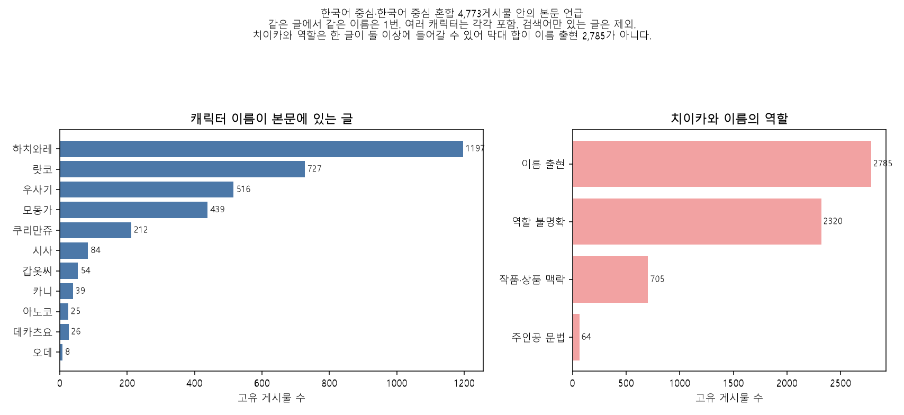
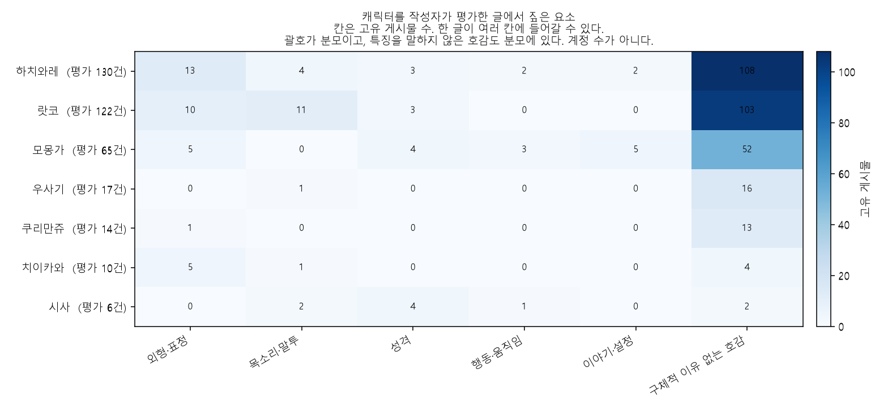
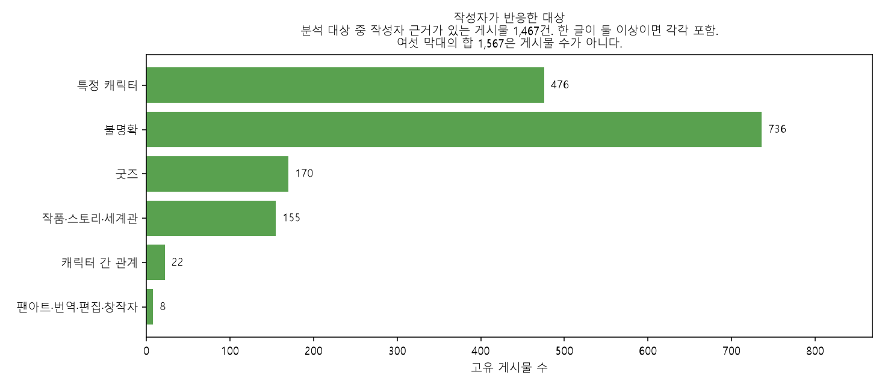
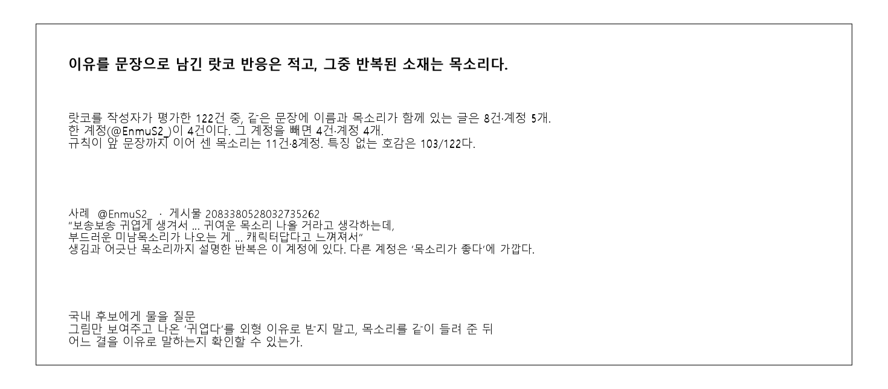

# 이름을 붙여 좋아해도, 이유를 말한 글은 적다

치이카와 관련 X 게시물에서 작성자가 어떤 캐릭터의 무엇을 짚고, 어떤 감정과 행동을 적었는지 정리했다. 단어가 같이 나왔다는 사실만으로 선호를 연결하지 않았다.

이 문서는 규칙 버전 `2026-11-03.reaction.v3`의 CSV와 집계표를 다시 읽어 구성했다. 분류를 다시 돌리거나 기준을 바꾸지 않았다. 사람 검수는 없다.

## 1) 핵심 요약

분석 대상은 2022년 1월 1일부터 2026년 10월 22일까지, 연도별 인기 게시물 1,000건씩 모은 5,000건 가운데 한국어 중심이거나 한국어가 중심인 혼합 글 **4,773건**이다.

1. **‘치이카와’는 대부분 주인공으로 확정되지 않는다.** 본문에 이름이 있는 글은 2,785건, 계정 1,324개다. 규칙이 주인공의 행동·몸·표정을 찾은 글은 64건이다. 작품이나 상품을 수식하는 글은 705건, 역할을 정하지 못한 글은 2,320건이다. 한 글이 두 역할에 들어갈 수 있어 세 수를 더하면 2,785보다 커진다.
2. **캐릭터 이름을 붙여 좋아한 글도 특징을 말하지 않는 쪽이 많다.** 하치와레를 평가한 130건 중 108건, 랏코 122건 중 103건, 모몽가 65건 중 52건이 그렇다. 분모는 그 캐릭터를 작성자가 평가한 글이고, 이유 없는 호감을 포함한다.
3. **랏코에게서 같은 문장에 이름과 목소리가 함께 있는 글은 8건, 계정 5개다.** 평가 122건이 분모다. 한 계정이 4건을 썼고, 그 계정을 빼면 4건·계정 4개다. 생김새와 어긋난 목소리까지 설명한 반복은 그 한 계정에 있다.
4. **모몽가는 귀여움과 설정의 불편이 한 캐릭터 안에 있다.** 평가 65건 중 이야기·설정은 5건, 성격은 4건이다. 문장 방향은 한쪽으로 모이지 않는다.
5. **친구 관계, 세계관, 상품에 옮긴 표정은 캐릭터 하나의 매력으로 세지 않았다.** 관계로 둔 글은 22건이다. 반응 대상을 정하지 못한 작성자 글은 736건이고, 그중 호감이 있는 글은 487건이다.

국내 후보 IP를 볼 때는 ‘귀엽다’를 외형 점수로 받지 말고, 그림·목소리·설정·상품을 서로 다른 질문으로 보여주는 편이 이 자료와 맞다. 이 5,000건은 연도별 인기 글이다. 전체 이용자 비율, 매출, 구매 전환, 연령, 장기 충성, 후보 IP의 성공으로 읽지 않는다.

## 2) 분석 목적과 질문

대원미디어가 국내 창작자의 캐릭터를 검토할 때, 어떤 그림·장면·상품 시안을 보여주고 무엇을 물어볼지 정하는 근거가 필요했다. 이번 분석이 답하려는 질문은 다섯 가지다.

- 누가 본문에서 언급되는가. 게시물 수와 계정 수는 얼마인가.
- 작성자는 외형, 표정, 목소리, 말투, 성격, 행동, 관계 중 무엇을 직접 짚는가.
- 감정과 행동(인용, 창작, 구매 희망, 획득, 사용)은 어떻게 적히는가.
- 여러 캐릭터에 공통인 반응과, 한 캐릭터에서 여러 계정이 반복한 반응은 무엇인가.
- 친구 사이, 작품 설정, 특정 장면, 상품의 구현처럼 캐릭터 한 명에게 돌리기 어려운 반응은 무엇인가.

검색어에 걸렸다는 사실, 이름만 있는 글, 판매 문구, 사진 속 굿즈를 작성자의 선호나 구매 이유로 바꾸지 않는 것이 목적에 포함된다.

## 3) 데이터 범위와 방법

### 자료

원본은 `02_csv/03_x/normalized/x_posts.csv`다. 게시물 5,000행, 고유 `post_id` 5,000개, 계정 2,503개다. 작성 시각은 2022-01-01 00:07부터 2026-10-22 21:50까지이고, 작성 연도마다 1,000건이다. 2026년은 10월 22일까지다.

검색어 연결 `x_post_keywords.csv`는 7,466행이다. 가리키는 게시물은 5,000개다. 한 게시물이 여러 검색어에 걸리므로 7,466을 게시물 수로 쓰지 않는다.

원본에는 인용·답글·리포스트를 잇는 ID가 없다. 본문이 `RT @`로 시작하는 글도 없다. 유형을 만들어 나누지 않았고, 본문에 적힌 대사와 번역만 작성자 말과 구분했다.

조회수가 비어 있는 글은 946건이고 모두 2022년이다. 빈칸을 0으로 채우지 않았다. 조회수 0으로 적힌 글은 0건이다. 좋아요·리포스트·조회수로 선호를 보정하지 않았다.

### 분석 단위와 분모

| 단위 | 파일 | 한 행의 의미 | 건수 |
| --- | --- | --- | --- |
| 게시물 | `post_reaction_analysis.csv` | 게시물 1건 | 5,000 |
| 근거 | `reaction_evidence.csv` | 게시물 안의 구절 1개 | 1,812행, 고유 게시물 1,571 |
| 집계 | `tables/01`~`13` | 이미 센 결과 | 게시물 수 아님 |

반응 비율의 기본 모집단은 한국어 중심 4,686건과 한국어 중심 혼합 87건을 합친 **4,773건**이다. 다른 언어 중심 189건과 언어를 나누기 어려운 38건은 반응 집계에서 뺐다. 언어로 국적, 거주지, 나이, 성별을 추정하지 않았다.

이름만 있는 글 3,663건은 언급에는 넣고, 평가 분모에는 넣지 않는다. 캐릭터별 매력 비율의 분모는 **그 캐릭터를 작성자가 평가한 고유 게시물**이다. 이유 없는 ‘귀엽다’도 분모에 있다. 같은 글에서 같은 캐릭터를 여러 번 적어도 한 번만 센다. 여러 캐릭터가 나오면 각각에 포함한다.

‘평가’는 호감, 웃음, 위로, 공감, 응원·보호, 비호감, 혼합이 있거나, 특징을 지목했거나, 직접 이유를 적은 글이다. 장면만 인용한 글은 언급·행동에는 남고 이 분모에는 들어가지 않는다.

본문에 이름이 있으면서 작성자가 무언가를 평가한 글(표 `05`의 `author_eval_posts`)과, 그 평가가 그 캐릭터를 향한 글(표 `06`의 `eval_posts`)은 다르다. 하치와레는 각각 297건과 130건이다. 매력 비율에는 130건을 쓴다.

### 처리 현황

| 구분 | 게시물 | 설명 |
| --- | --- | --- |
| 입력 | 5,000 | 읽기 실패 없음 |
| 분석 대상 | 4,773 | 한국어 중심, 한국어 중심 혼합 |
| 언어 때문에 제외 | 227 | 다른 언어 189, 판단 불가 38 |
| 이름만 있음 | 3,663 | 분석 대상 안. 언급용으로 보존 |
| 작성자 평가 있음 | 1,105 | 대상이 캐릭터가 아닐 수 있음 |
| 검토 필요 표시 | 663 | 아래 깃발은 한 글에 여러 개일 수 있음 |
| 근거 구절 | 1,812행 | 게시물 수로 쓰지 않음 |

검토 깃발은 겹친다. 고유 게시물은 663건이다. 애매한 이름 6, 다른 대상으로 제외한 표기 3, 부정·반어 19, 여러 캐릭터 298, 홍보와 개인 감상 12, 홍보와 개인 거래 16, 첨부 확인 필요 11, 치이카와 역할이 불명확한데 평가가 있는 글 487이다.

### 자동 분류와 실제 검토

5,000건 전부에 같은 규칙을 적용했다. 규칙을 만들기 전에 연도·목적·이름이 다른 142건을 읽었다. 그다음 특징을 지목했거나 직접 이유가 있는 근거 107행(게시물 105건)과, 규칙 작성과 겹치지 않는 점검 표본 56건을 모델이 읽었다. 모델이 분류를 고친 게시물은 0건이다. 사람 검수는 없다. 사진과 영상은 열지 않았다.

규칙이 만든 확인 9개 중 8개는 기대와 맞았다. 나머지 1개는 판매 글 `1581247470121910272`다. 이 글은 작성자 평가 행이 없고 목적은 판매·홍보다. 기대한 ‘홍보 화자’ 행이 없는 것은 평가가 없을 때 근거 행을 만들지 않는 설계와 맞다. 결과를 고치지 않았다.

## 4) 질문별 주요 결과

### 4.1 누가 언급되는가

**확인된 사실.** 검색어와 본문 언급은 다르다. ‘하치와레’로 모인 1,207게시물 중 본문에 그 표기가 없는 글은 12건이다. ‘치이카와’ 검색 3,009건 중 그런 글은 55건이다. 아래 막대는 분석 대상 4,773건 안에서 본문 표기가 있는 고유 게시물이다.

확인되는 내용: 하치와레 1,197건, 랏코 727건, 우사기 516건, 모몽가 439건 순이다. 치이카와 이름 2,785건 가운데 주인공 문법 64건, 작품·상품 705건, 역할 불명확 2,320건이다.

판단할 수 없는 내용: 막대 길이를 인기 순위나 시장 크기로 읽을 수 없다. 표본은 해마다 같은 수만큼 뽑은 인기 글이다. 계정 수는 사람 수가 아니다.

치이카와 세 역할이 겹친 글은 301건이다. 주인공으로 표시된 64건 중 22건은 불명확 역할도 있고, 4건은 작품 역할도 있다. 주인공 역할만 있는 글은 41건이다. 다른 캐릭터가 같이 있다는 이유만으로 주인공으로 세지 않았다.

이름만 있는 글이 언급의 큰 부분이다. 하치와레 1,197건 중 900건, 랏코 727건 중 548건이 이름만 있다.

‘가르마’만 있고 ‘하치와레’가 없는 글 21건, 짧은 ‘하치·치이’는 캐릭터 수에 넣지 않았다. ‘락코’ 2건은 랏코에 포함했다. ‘라코’만 있는 글은 0건이다. ‘우사기·시사·카니’는 다른 뜻일 수 있어 앞뒤가 치이카와 맥락일 때만 캐릭터로 두었다.

**해석.** 작품명과 주인공 이름이 같으면, 이름 언급이 많은 것을 주인공의 성격·외형 선호로 받으면 안 된다. 이 자료에서 주인공으로 연결된 작성자 평가는 10건, 계정 8개다.

**한계.** 64건에는 표정 단어 때문에 주인공으로 남은 상품 문장도 1건 들어 있다. 해당 글은 4.5의 인형 사례다.

### 4.2 무엇을 좋아하는가

**확인된 사실.** 아래 히트맵의 한 칸은 고유 게시물 수다. 괄호가 분모다. 한 글이 여러 칸에 들어갈 수 있다. 상품 칸은 랏코 2, 모몽가 2, 치이카와 1뿐이라 그림에서는 뺐고 표에 남겼다. 평가 6건 미만 캐릭터도 그림에서 뺐다.

| 캐릭터 | 평가 게시물 | 계정 | 특징 없는 호감 | 외형·표정 | 목소리·말투 | 성격 | 이야기·설정 | 직접 이유 |
| --- | --- | --- | --- | --- | --- | --- | --- | --- |
| 하치와레 | 130 | 116 | 108 | 13 | 4 | 3 | 2 | 7 |
| 랏코 | 122 | 74 | 103 | 10 | 11 | 3 | 0 | 6 |
| 모몽가 | 65 | 61 | 52 | 5 | 0 | 4 | 5 | 5 |
| 우사기 | 17 | 17 | 16 | 0 | 1 | 0 | 0 | 1 |
| 쿠리만쥬 | 14 | 12 | 13 | 1 | 0 | 0 | 0 | 0 |
| 치이카와 | 10 | 8 | 4 | 5 | 1 | 0 | 0 | 1 |
| 시사 | 6 | 5 | 2 | 0 | 2 | 4 | 0 | 2 |

칸을 더해도 분모가 되지 않는다. 하치와레는 특징 없는 호감 108건이 다른 특징과 겹치지 않고, 특징을 하나라도 지목한 글은 22건이다. 랏코는 103건 중 1건만 다른 특징과 같은 글이고, 목소리 11건은 그 103건에 들어 있지 않다. 모몽가는 52건 중 1건만 다른 특징과 겹친다.

우사기가 17건으로 작은 것은 우사기를 덜 좋아한다는 뜻이 아니다. `치이카와 우사기 너무 귀여워`처럼 이름을 나열한 호감은 한 캐릭터로 돌리지 않고 불명확에 남겼다. 그렇게 대상이 불명확한 작성자 글은 736건이고, 호감이 적힌 것은 487건, 계정 376개다.

**대표 원문.** 특징이 없는 호감이 분모의 다수라, 여기 인용은 ‘이유를 말한 소수’다. 다수를 대표하는 문장은 “귀엽다” 한 마디다.

하치와레 외형 13건은 앞머리, 표정 변화, 주둥이, 뒷모습처럼 글마다 다르다. 13건을 하나의 외형 공식으로 모으지 않는다.

**해석.** 팬에게 그림만 보여주고 받은 ‘귀엽다’는, 이 자료에서는 대부분 외형 이유가 아니다. 이유를 한 문장으로 말하게 해야 외형·목소리·설정이 갈린다.

**한계.** 포괄 호감 전체와 이름만 있는 글을 한 줄씩 다시 읽지는 않았다. 자동 분류다. 점검 표본에서 `좋아하는 건 아님`이 호감으로 남은 글이 1건 있다. 위 표는 그 한 글에 기대지 않는다.

### 4.3 어떻게 표현하는가

**확인된 사실.** 작성자 근거가 있는 분석 대상 게시물은 1,467건이다. 근거 수준별 고유 게시물은 언급 또는 행동만 1,322건, 특징 지목 125건, 직접 이유 47건이다. 27건은 수준이 두 가지라 세 수의 합은 1,467보다 큰 1,494다.

감정은 캐릭터 평가 안에서 호감이 가장 많다. 하치와레 114/130, 랏코 106/122, 모몽가 54/65다. 비호감·불편은 세 캐릭터 모두 1건이다. 한 글에 호감과 웃음이 같이 있을 수 있다.

행동을 캐릭터에 연결한 수는 평가 분모보다 크다. 장면을 인용하기만 한 글이 포함되기 때문이다. 분모는 ‘그 캐릭터를 향한 작성자 근거가 있는 글’이다.

| 캐릭터 | 근거 게시물 | 장면·대사 인용 | 구매·소장 희망 | 구매·획득 경험 | 사용·휴대·전시 |
| --- | --- | --- | --- | --- | --- |
| 하치와레 | 164 | 33 | 4 | 6 | 3 |
| 랏코 | 151 | 25 | 8 | 5 | 0 |
| 모몽가 | 77 | 14 | 5 | 2 | 1 |

구매 희망과 구매 경험은 다른 칸이다. 같은 글에 상품 이름과 호감이 있어도, 그 호감이 구매 이유라는 문장이 없으면 연결하지 않았다.

**해석.** 이 표본에서 작성자가 많이 하는 일은 이유를 설명하는 일보다 이름을 적거나 장면을 옮기는 일이다. 구매 문장은 호감 문장보다 훨씬 적다. 적다고 해서 구매가 적다는 뜻은 아니다. 구매를 적지 않은 사람이 많다는 뜻이다.

**한계.** 인기 글 표본이라 짧은 감탄이 길어진다. 비호감이 1건이라는 것은 이 표본 안의 결과다. 전체 게시물의 부정 비율이 아니다. 판매·공동구매·양도 문구는 개인 경험과 나누었고, 둘 다 있으면 근거를 각각 남겼다.

### 4.4 캐릭터마다 다른 점

**공통.** 하치와레, 랏코, 모몽가 모두 이름을 붙인 평가의 다수가 특징 없는 호감이다. 하치와레를 향한 작성자 근거 164건 중 가장 많은 계정은 5건이다. 한 계정이 하치와레 비율을 만들지 않는다.

**랏코와 목소리.** 평가 122건 중 목소리·말투는 11건, 계정 8개다. 이 11건에는 앞 문장의 이름을 이어 붙인 글 3건이 있다. 근거 구절 안에 `랏코`와 목소리·성우가 함께 있는 글만 세면 **8건, 계정 5개**다. @EnmuS2_가 4건이다. 그 계정을 빼면 4건, 계정 4개다.

같은 122건 중 42건은 @goldengyul이다. 이 계정은 목소리 8건에 없다. 이 계정을 뺀 평가 80건 중 특징 없는 호감은 63건이다. 호감이 이유를 동반하지 않는다는 점은 그 계정을 빼도 남는다.

대표 문장. @EnmuS2_, 게시물 [2083380528032735262](https://x.com/EnmuS2_/status/2083380528032735262).

> 랏코 되게 보송보송 귀엽게 생겨서 애니나 내용 모르는사람들은 귀여운 목소리 나올거라고 생각하는데, 난 요런 부드러운 미남목소리 나오는게 … 캐릭터 답다고 느껴져서

이 문장은 직접 이유이고, 그 이유가 설명하는 대상은 호감이다. 생김과 어긋난 목소리까지 적은 반복은 이 계정에 있다.

다른 계정은 한 줄에 가깝다. @Jungh0915, [1805544593821516135](https://x.com/Jungh0915/status/1805544593821516135), “오ㅓ 랏코 목소리 왤케 좋음”. @game_yaregi, [1826582742358000121](https://x.com/game_yaregi/status/1826582742358000121), “랏코 한국 성우분 날 너무 미치게함”. 뒤의 글은 캐릭터 목소리와 성우 반응이 한 문장에 있다.

반례. 같은 122건 중 특징 없는 호감이 103건이다. 표정 10건은 장면마다 다르다. “랏코 마스코트는 정말 부들부들하고 귀여워… 진짜 부드러워서”([1576575622390087680](https://x.com/vvvewww/status/1576575622390087680))는 상품의 촉감으로 기록되어 목소리 11건에 들어 있지 않다.

**모몽가.** 평가 65건, 계정 61개. 이야기·설정 5건과 성격 4건은 방향이 다르다.

- @ninini0421, [1947461112934633483](https://x.com/ninini0421/status/1947461112934633483). “모몽가 귀여워서 좋아했다가 스토리 알고나서 … 그놈이 얼마나 간악한 애인줄 아냐고”. 직접 이유. 호감을 설명하면서 설정을 말한다.
- @bambiinurheart, [2027071708818293207](https://x.com/bambiinurheart/status/2027071708818293207). “모몽가 설정 알려주면 10에 9는 진심으로 징그럽다고 … 그래서좋아하는건데”. 자동 분류는 특징 지목이다. ‘10에 9’는 이 작성자의 말이지 측정값이 아니다.
- @Goguma_022, [2082776340969971918](https://x.com/Goguma_022/status/2082776340969971918). “원본모몽가가 너무 불쌍해서”.
- @myau09731, [1738108982877995181](https://x.com/myau09731/status/1738108982877995181). “크리스마스 모몽가 너무 뚠빵해서 기여워”. 외형이 이유인 글이다.

**해석.** 반복해서 문장으로 남은 구체적 소재는 캐릭터마다 다르다. 랏코에서는 목소리가 여럿의 글에 나타나고, 모몽가에서는 귀여운 인상과 불편한 설정이 같이 남는다. 건수가 작으므로 순위는 되지 않는다.

**한계.** 목소리 8건 중 4건이 한 계정이다. 8건을 랏코를 좋아하는 이유 전체로 키우지 않는다. 모몽가 설정 5건 중 1건은 “본캐가 이 세계관에서 제일 귀엽다”에 가깝다. 다섯 건 모두가 긴 설정 해설은 아니다.

### 4.5 한 캐릭터에게 돌릴 수 없는 반응

**확인된 사실.** 작성자 근거 1,467건을 반응 대상으로 나누면 아래와 같다. 99건은 대상이 둘 이상이라 막대 합 1,567은 게시물 수가 아니다.

확인되는 내용: 특정 캐릭터 476건, 불명확 736건, 굿즈 170건, 작품·스토리·세계관 155건, 관계 22건, 팬아트·번역·편집·창작자 8건이다. 직접 이유는 특정 캐릭터 23건, 불명확 16건, 굿즈 3건, 작품 3건, 관계 1건, 팬아트 1건이다.

판단할 수 없는 내용: 불명확 736건을 특정 캐릭터의 인기로 나누어 넣을 수 없다. 첨부를 열지 않았으므로 사진만으로 알 수 있는 대상은 여기 남는다.

관계 22건, 계정 21개, 직접 이유 1건. @lduvim, [2085951406184554868](https://x.com/lduvim/status/2085951406184554868).

> 우사기가 갑옷씨 허리에 달라붙어서 가는 것도 넘 귀엽다

같은 글의 “하치와레 말하면서 팔 움직이는 것도 귀엽고”는 하치와레 쪽 근거로 따로 있다. 한 문장의 귀여움을 두 캐릭터에 나누어 넣지 않았다.

작품. @unzeori, [2048749393806041472](https://x.com/unzeori/status/2048749393806041472).

> 세계관이 생각보다 현실적이어서 … 우정을 지속하고 두렵지만 꾸준히 용기 내는 모습이 너무 귀엽고 와닿았던 것 같애

이 구절의 반응 대상은 작품·스토리·세계관이고, 이유가 설명하는 감정은 호감이다. 캐릭터 칸은 비어 있다. 같은 글의 다른 구절에는 치이카와 호감이 따로 있다.

상품. @To_Dot_, [1571131866656407554](https://x.com/To_Dot_/status/1571131866656407554).

> 치이카와 하나도 모르지만 이 인형 표정이 너무 취향으로 귀여워서 계속 생각나길래 구매걸어놓고

반응 대상은 굿즈, 행동은 구매·소장 희망, 이유는 그 희망을 설명한다. 구매가 끝났는지는 이 문장만으로 확인되지 않는다. 규칙의 역할 칸은 표정 단어 때문에 주인공으로 남아 있다. 문장 자체는 캐릭터를 모른다고 말한다. 주인공 성격의 근거로 쓰지 않는다.

@dd_officiaI, [1652949157995507712](https://x.com/dd_officiaI/status/1652949157995507712). “치이카와 키링은 키링부분이 별모양인게 너무 기여워서 샀어”. 행동은 구매·획득 경험이고, 이유는 키링 형태다.

굿즈로 직접 이유가 기록된 글은 3건이다. 위의 인형·키링 2건 외에 1건(`2075981471882637492`)은 하치와레를 좋아하는 방식에 사람을 빗댄 문장이다. 상품 디자인 이유로 세지 않는다. 표의 3건은 그대로 두고, 상품 이유로 읽는 것은 2건이다.

**해석.** 보여주는 시안을 캐릭터 얼굴, 친구끼리 돕는 장면, 세계관의 긴장, 상품에 옮긴 표정으로 나누면 이 게시물의 문장 단위와 맞다.

**한계.** 짧은 이름 ‘하치·치이’로 적힌 관계 장면은 자동 집계 22건 밖에 있다. 22건은 하한에 가깝고, 더 큰 수로 보정하지는 않았다. 사진에 굿즈가 있어도 구매자와 구매 이유까지 정하지 않았다.

## 5) 프로젝트 시사점

사실과 검토 질문을 나눈다. 질문은 이 자료가 대신 답할 수 없는 부분이다.

| 확인된 사실 | 국내 후보에게 물어볼 질문 | 이 자료로 말하지 않는 것 |
| --- | --- | --- |
| 치이카와 이름 2,785건 중 주인공 문법 64건 | 작품명과 주인공 이름이 같은가. 이름만 많은 반응을 누구의 선호로 받을 것인가 | 주인공이 가장 사랑받는다는 결론 |
| 이름을 붙인 평가의 다수가 이유 없음. 하치와레 108/130, 랏코 103/122 | 그림만 보고 나온 ‘귀엽다’를 외형 이유로 받지 않고, 이유를 한 문장으로 말하게 할 수 있는가 | 외형 선호의 시장 비율 |
| 랏코 평가 122건 중 같은 문장 목소리 8건·계정 5개. 한 계정이 4건 | 목소리를 같이 들려 준 뒤, 부드러운지·귀여운지·성우인지 어느 결을 말하는지 | 8건이 전체 팬의 구매 이유라는 결론 |
| 모몽가 평가 65건 중 설정 5건, 성격 4건. 방향이 갈림 | 귀여운 외형과 불편한 설정을 같이 보여줄 때 어느 쪽을 문장으로 남기는가 | 모몽가가 설정을 더 중시한다는 순위 |
| 관계 22건, 작품 이유와 상품 이유가 별도 구절 | 친구 장면, 세계관, 상품 표정을 서로 다른 질문으로 나누었는가 | 굿즈 매출, 구매 전환 |

발표용으로 고른 한 장은 언급량이 가장 큰 결과가 아니다. ‘왜 좋아하는가’에 직접 답하는 쪽을 골랐다.

카드의 문장: 이유를 문장으로 남긴 랏코 반응은 적고, 그중 반복된 소재는 목소리다. 분모는 랏코 평가 122건, 핵심 수는 같은 문장 8건·계정 5개다.

## 6) 한계와 다음 단계

- 5,000건은 연도별 인기 글이다. 언급이 늘어난 것을 시장 성장으로, 여러 해의 이름을 같은 팬의 장기 충성으로 읽지 않는다. 2026년은 10월 22일까지다.
- 자동 규칙이 5,000건을 분류했다. 모델이 읽은 범위는 규칙용 142건, 특징·이유 107행, 점검 56건이다. 사람 검수는 없다.
- 조회수 결측 946건은 2022년에만 있다. 0으로 바꾸지 않았고, 선호 보정에 쓰지 않았다.
- 첨부 11건은 본문만으로 대상을 정하지 못해 확인 필요로 남겼다. 이미지를 연 자료와 열지 못한 자료를 구분하면, 열어서 판정한 이미지는 0건이다.
- 근거 구절의 앞부분은 주소와 멘션을 지우고 공백을 맞춘 본문에서 모두 찾았다. 구절 행 1,812를 게시물 수로 쓰지 않는다.
- ‘가르마’만 있는 21건과 짧은 ‘하치·치이’는 집계 밖에 있다. 관계 장면이 빠져 있을 수 있다.
- 치이카와 역할이 불명확하면서 평가가 있는 글 487건과, 대상이 불명확하면서 호감이 있는 글 487건은 숫자가 같고 겹치는 글은 361건이다. 같은 집합이 아니다.
- 계정 수는 사람 수가 아니다. 결론을 바꿀 만큼 한 계정이 큰 곳은 랏코 평가(42/122)와 랏코 목소리(4/8)뿐이고, 그 계정을 뺀 수를 같이 적었다.

다음에 보려면 사진·영상이 있어야 대상이 정해지는 11건, 그리고 ‘가르마’ 21건을 사람이 읽는 일이 먼저다. 매출, 연령, 국내 후보의 성공 여부는 다른 자료가 필요하다.

## 7) 출처와 부록

- 규칙 버전: `2026-11-03.reaction.v3`
- 입력: `normalized/x_posts.csv`, `x_post_keywords.csv`, `x_keywords.csv`, `x_post_sources.csv`, `x_source_files.csv`
- 게시물 결과: `post_reaction_analysis.csv` (5,000행)
- 근거: `reaction_evidence.csv` (1,812행)
- 이름만 있는 글: `name_only_posts.csv` (3,663행)
- 검토 표시: `review_required.csv` (663행)
- 집계: `tables/01_scope.csv`부터 `13_review_flags.csv`
- 기준: `character_dictionary.md`
- 그림: `charts/01_character_mentions.png`, `02_character_appeal_heatmap.png`, `03_x_evidence_card.png`, `04_reaction_targets.png`
- 실행: Python 3.11로 `working/analyze_reactions.py`, 이어서 `working/make_charts.py`. 원본 CSV는 수정하지 않았다.

재현할 때는 문자열 결측을 추론하지 않고 읽고, 조회수 빈칸을 빈칸으로 둔다. 표 `05`의 언급 수와 표 `06`의 평가 수를 한 열로 합치지 않는다.
